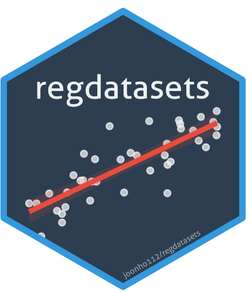

<!-- README.md is generated from README.Rmd. Please edit that file. -->

```{r, include = FALSE}
knitr::opts_chunk$set(
  collapse = TRUE,
  comment = "#>",
  fig.path = "man/figures/README-",
  out.width = "100%"
)
library(regdatasets)
n_datasets <- nrow(list_datasets())
```

# regdatasets 

<!-- badges: start -->
[](https://github.com/joonho112/regdatasets/actions/workflows/R-CMD-check.yaml)
[](https://lifecycle.r-lib.org/articles/stages.html#stable)
<!-- badges: end -->

**regdatasets** provides `r n_datasets` datasets for teaching introductory and
intermediate regression analysis in education and the social sciences:
simple and multiple regression, ANOVA and ANCOVA, interactions, model building
and diagnostics, logistic regression, latent-response models and ordinal models.

The data come from published studies, textbooks and public archives. Every
dataset is rebuilt reproducibly from its source, cleaned of missing-value codes,
and documented variable by variable.

## Installation

```r
# install.packages("remotes")
remotes::install_github("joonho112/regdatasets")

# or a fixed release (recommended for a course, so results never change):
remotes::install_github("joonho112/regdatasets@v1.0.0")
```

## Find a dataset

```{r datasets}
library(regdatasets)
knitr::kable(list_datasets()[, c("dataset", "title", "rows", "cols", "topics")])
```

Filter by topic, for example `list_datasets(topic = "logistic")`.

## Understand its variables

Each dataset has a help page (for example `?titanic`). The same information is
available as a data frame:

```{r codebook}
codebook("titanic")[, c("variable", "label", "values")]
```

## Fit a model

```{r model}
fit <- glm(survived ~ factor(pclass) + sex + age, data = titanic, family = binomial)
round(summary(fit)$coefficients, 3)
```

## How the data are built

The files in `data/` are build outputs and are never edited by hand. The
script `data-raw/build_all.R` rebuilds every dataset from checksummed source
files, one recipe per dataset, and refuses to save data that break the data
contract in `data-raw/CONTRACT.md`. The folder `data-raw/audit/` records every
difference from the previous version and the decision that approved it. See
[NEWS](https://github.com/joonho112/regdatasets/blob/main/NEWS.md) for what
changed in version 1.0.0.

## Sources and licensing

The code and documentation are released under the MIT license. The datasets
come from the published sources cited on each help page and in
[LICENSE.note](https://github.com/joonho112/regdatasets/blob/main/LICENSE.note),
which also records why each one may be redistributed. Most datasets reached
this package as teaching extracts used in the course EDUC 275B at the Graduate
School of Education, University of California, Berkeley.

## Citation

```{r citation, echo = FALSE, comment = ""}
print(citation("regdatasets"), style = "text")
```
