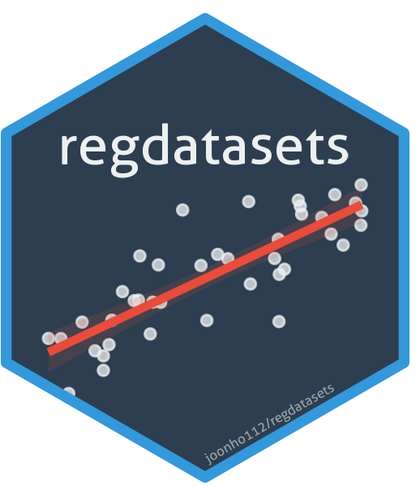

<!-- README.md is generated from README.Rmd. Please edit that file. -->

# regdatasets 

<!-- badges: start -->

[](https://github.com/joonho112/regdatasets/actions/workflows/R-CMD-check.yaml)
[](https://lifecycle.r-lib.org/articles/stages.html#stable)
<!-- badges: end -->

**regdatasets** provides 22 datasets for teaching introductory and
intermediate regression analysis in education and the social sciences:
simple and multiple regression, ANOVA and ANCOVA, interactions, model
building and diagnostics, logistic regression, latent-response models
and ordinal models.

The data come from published studies, textbooks and public archives.
Every dataset is rebuilt reproducibly from its source, cleaned of
missing-value codes, and documented variable by variable.

## Installation

``` r
# install.packages("remotes")
remotes::install_github("joonho112/regdatasets")

# or a fixed release (recommended for a course, so results never change):
remotes::install_github("joonho112/regdatasets@v1.0.0")
```

## Find a dataset

``` r
library(regdatasets)
knitr::kable(list_datasets()[, c("dataset", "title", "rows", "cols", "topics")])
```

| dataset | title | rows | cols | topics |
|:---|:---|---:|---:|:---|
| alcohol1_pp | Adolescent alcohol use (person-period data) | 246 | 9 | multilevel-longitudinal |
| berk_sub | Berkeley graduate admissions: two departments | 1169 | 3 | logistic |
| berkeley | Berkeley graduate admissions: five departments | 3593 | 3 | logistic |
| classdata_07 | Simulated class survey | 44 | 12 | simple-regression |
| crime | Florida county crime rates | 67 | 5 | continuous-predictors, nonlinear |
| disc | School discipline: NELS:88 original items | 2000 | 15 | logistic, ordinal |
| disc2 | School discipline: NELS:88 with SES and test scores | 2000 | 15 | logistic, ordinal |
| faculty | Faculty salaries | 514 | 10 | interactions, continuous-predictors |
| gcse | GCSE and London Reading Test scores | 4059 | 5 | simple-regression, ancova, interactions, nonlinear, model-building, diagnostics, multilevel-longitudinal |
| grades | Essay grades and text features | 198 | 8 | ordinal, glm-latent |
| gss_1 | General Social Survey 1998 | 2832 | 16 | logistic |
| hsb_sub | High School and Beyond: five schools | 188 | 7 | interactions, model-building, diagnostics, multilevel-longitudinal |
| hsbs1 | High School and Beyond: 350 students | 350 | 16 | diagnostics, model-building |
| individuals | Earnings, education and job sector (CPS 2000) | 55899 | 6 | interactions, anova |
| instruction | Teachers’ math knowledge and first-grade math gains | 1190 | 12 | anova, simple-regression, multilevel-longitudinal |
| nels_data | NELS:88 base year and first follow-up (2,000 students) | 2000 | 299 | model-building, diagnostics |
| penalty | Death-penalty verdicts in Florida | 674 | 3 | logistic, diagnostics |
| pisa2000 | PISA 2000 reading: UK, Germany and USA | 4528 | 15 | anova, interactions, simple-regression, logistic |
| reading | Reading comprehension experiment | 66 | 8 | anova, ancova |
| satisfaction | Job satisfaction by income and gender | 110 | 3 | ordinal |
| titanic | Titanic passenger survival | 1309 | 6 | logistic, glm-latent |
| womenlf | Canadian women’s labour-force participation | 263 | 5 | ordinal, logistic |

Filter by topic, for example `list_datasets(topic = "logistic")`.

## Understand its variables

Each dataset has a help page (for example `?titanic`). The same
information is available as a data frame:

``` r
codebook("titanic")[, c("variable", "label", "values")]
#> # A tibble: 6 × 3
#>   variable label               values                                           
#>   <chr>    <chr>               <chr>                                            
#> 1 pclass   Passenger class     1 = first class; 2 = second class; 3 = third cla…
#> 2 survived Survived            0 = died; 1 = survived                           
#> 3 age      Age                 <NA>                                             
#> 4 fare     Passenger fare      <NA>                                             
#> 5 embarked Port of embarkation C = Cherbourg; Q = Queenstown; S = Southampton   
#> 6 sex      Sex                 0 = male; 1 = female
```

## Fit a model

``` r
fit <- glm(survived ~ factor(pclass) + sex + age, data = titanic, family = binomial)
round(summary(fit)$coefficients, 3)
#>                 Estimate Std. Error z value Pr(>|z|)
#> (Intercept)        1.024      0.296   3.457    0.001
#> factor(pclass)2   -1.281      0.226  -5.678    0.000
#> factor(pclass)3   -2.290      0.226 -10.140    0.000
#> sex                2.498      0.166  15.044    0.000
#> age               -0.034      0.006  -5.433    0.000
```

## How the data are built

The files in `data/` are build outputs and are never edited by hand. The
script `data-raw/build_all.R` rebuilds every dataset from checksummed
source files, one recipe per dataset, and refuses to save data that
break the data contract in `data-raw/CONTRACT.md`. The folder
`data-raw/audit/` records every difference from the previous version and
the decision that approved it. See
[NEWS](https://github.com/joonho112/regdatasets/blob/main/NEWS.md) for
what changed in version 1.0.0.

## Sources and licensing

The code and documentation are released under the MIT license. The
datasets come from the published sources cited on each help page and in
[LICENSE.note](https://github.com/joonho112/regdatasets/blob/main/LICENSE.note),
which also records why each one may be redistributed. Most datasets
reached this package as teaching extracts used in the course EDUC 275B
at the Graduate School of Education, University of California, Berkeley.

## Citation

    Lee J (2026). _regdatasets: Datasets for Teaching Regression Analysis_.
    R package version 1.0.0, <https://joonho112.github.io/regdatasets/>.
